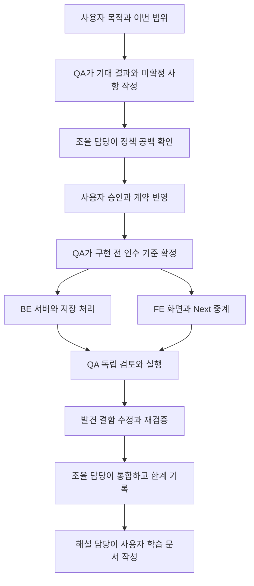
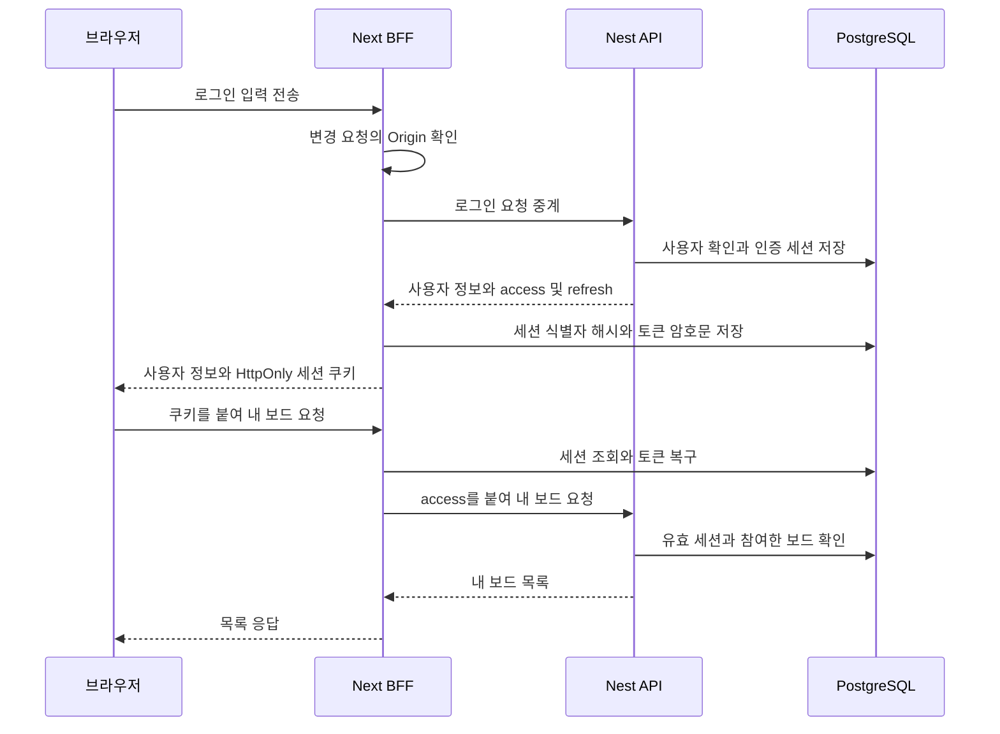
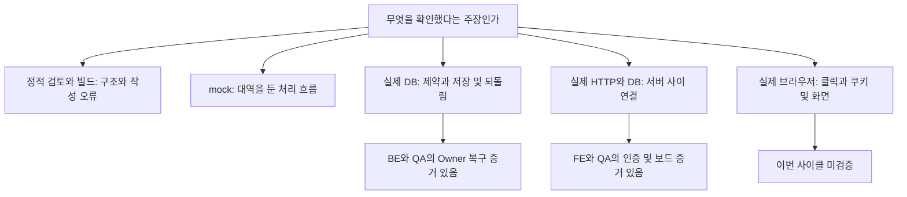

# 사이클 01 — 로그인과 내 보드를 만들고 실제 저장까지 확인하기

작성 기준: 2026-10-12, 통합 브랜치 `codex/orchestration`의 `25ab91f`.
이 글은 여러 작업 배치를 하나의 학습 흐름으로 묶습니다. 모든 단계가 한 번에 진행된 것은 아닙니다.

이번에 로그인·가입·내 보드·보드 생성·로그아웃의 서버 연결과 임시 화면이 마련됐고, 격리된 실제 데이터베이스에서 정해진 검사가 통과했습니다.
실제 브라우저 클릭, HTTPS 환경의 쿠키 동작, Figma 디자인 일치, 전체 업무 규격의 통과는 아직 확인하지 않았습니다.

## 1. 사용자가 원한 것에서 출발하기

사용자의 큰 목적은 여러 개발 담당자가 Taskify를 함께 만들고, 그 과정을 이해할 수 있게 하는 것입니다.
이번 작업에서는 “가입하고 로그인한 뒤 내가 참여한 보드를 보고 만들며, 로그아웃할 수 있는가”를 작은 범위로 잡았습니다.
겉으로는 몇 개의 화면이지만, 누가 로그인했는지 기억하고 다른 사람의 보드를 숨기며 실패한 저장을 되돌리는 처리가 필요합니다.

코드를 보지 않고 읽으려면 2절의 역할 표, 3절의 협업 그림, 5절의 인증 그림, 7절의 결함 사례, 8절의 증거 표 순서로 보세요.
낯선 말은 마지막 용어표에서 다시 확인할 수 있습니다.

## 2. 누가 무엇을 맡았나

오케스트레이션은 여러 담당자의 작업 순서와 인계를 조율하는 일입니다.
오케스트라에 비유하면 조율 담당은 지휘자와 비슷하지만, 지휘만으로 코드가 정확해지지는 않습니다. 계약과 실행 결과로 다시 확인해야 합니다.

| 역할 | 쉬운 설명 | 이번 산출물과 책임 |
|---|---|---|
| 사용자 | 제품이 어떻게 행동할지 결정 | 로그인 유지 방식, 기본 색상, 목록 순서 등의 승인 |
| 조율 담당 | 범위를 나누고 결과를 모음 | 작업 배정, 승인 반영, 통합 브랜치 관리, 서버 재시작·종료 조율 |
| QA: 품질 검증 담당 | 기대 결과를 먼저 쓰고 독립 확인 | 인수 문장, 구현 검토, 실제 DB·HTTP 검사 결과 |
| BE: 백엔드 담당 | 서버의 규칙과 저장 처리 | 인증, 보드 API, 데이터 제약, Owner 오류 복구 |
| FE: 프런트엔드 담당 | 화면과 브라우저 쪽 연결 | 임시 화면, Next 서버 중계, 쿠키·서버 세션 검증 |
| 해설 담당 | 흩어진 결과를 학습 흐름으로 묶음 | 이 문서와 근거 링크, 검증 범위와 남은 일 설명 |

API는 프로그램끼리 요청과 응답을 주고받는 창구입니다. HTTP는 여기서 쓰는 웹 통신 방식입니다.
HTTP 응답 번호는 결과를 짧게 표시합니다. 여기서는 401은 인증 거절, 403은 접근 거절, 409는 현재 상태와의 충돌, 422는 입력 오류를 뜻합니다.
FE와 BE가 같은 창구의 입력·출력을 약속한 문서가 계약이며, 이 저장소에서는 OpenAPI 문서도 그 역할을 합니다.
각 담당자는 별도 작업 폴더인 Worktree와 별도 변경 흐름인 브랜치에서 일해 충돌을 줄였습니다.
분리된 작업도 합칠 때는 상대방의 최신 계약과 결과를 확인해야 합니다.

근거: [작업판](../../agents/BOARD.md), [조율 기록](../../agents/shared/orchestration-2026-10-11.md).

## 3. 왜 QA가 먼저 문장을 썼나

인수 문장은 “어떤 조건에서 무엇이 일어나야 통과인가”를 적은 문장입니다.
예를 들어 “멤버가 아닌 사람에게 보드를 보여 주지 않는다”는 성공 화면뿐 아니라 거절 상황도 정합니다.
QA는 기존 업무 규격 13개를 보존하고, 인증·중계 9개와 인증·내 보드 HTTP 11개를 단계별로 추가했습니다.
총 33개의 문서화된 규격이 있다는 뜻이며, 33개를 모두 실행하거나 통과했다는 뜻은 아닙니다.

그림은 반복되는 협업 원리입니다. 실제로는 초기 검토에서 공백을 찾은 뒤 승인을 받기도 했고, 승인된 범위의 새 QA 문장을 먼저 확정한 뒤 BE·FE가 병행하기도 했습니다.
공통 기준이 있으므로 FE는 중계와 화면을, BE는 저장과 인증을 동시에 진행할 수 있었습니다.
다만 FE에 중계 주소가 있다고 해서 그 주소가 연결할 BE 기능까지 완성된 것은 아닙니다.

근거: [QA 인수 문장과 인계 이력](../../agents/qa/OUTBOX.md).

## 4. 구현 전에 결정해야 했던 정책

정책은 코드 작성자가 임의로 정하는 편의 설정이 아니라 사용자가 기대하는 제품 동작입니다.
QA는 보드 기본 색상이 코드에 있는데 승인 근거가 없는 공백도 지적했습니다. 이후 사용자 승인과 계약 기록으로 이를 해소했습니다.

| 승인 항목 | 쉬운 뜻 | 구현에 영향을 주는 부분 |
|---|---|---|
| 기본 색상 `#5534DA` | 색을 고르지 않으면 보라색 | 보드 생성의 기본값 |
| 최근 참여한 보드부터 | 참여 시각 내림차순, 같으면 보드 ID 내림차순 | 목록 조회와 다음 페이지 |
| 잘못된 cursor는 422 | 잘못된 페이지 책갈피는 입력 오류 | 오류 응답과 화면 안내 |
| 이메일 원문 비교 | 대소문자 변경·공백 제거 없이 형식 검사와 비교 | 가입과 로그인 |
| 삭제된 책갈피 기준 보드 | 저장된 정렬 경계 뒤에서 계속 조회 | 해당 보드가 없어도 다음 페이지 처리 |
| access 15분, refresh 절대 7일 | 짧은 인증표를 갱신해도 최초 로그인 만료일은 연장하지 않음 | 인증 수명과 갱신 |
| 현재 로그인만 로그아웃 | 다른 로그인 연결은 유지 | 세션 폐기와 보호 요청 거절 |
| 브라우저 인증 B안 | Next 서버가 토큰을 보관하고 브라우저에는 세션 쿠키 전달 | 서버 중계와 저장 구조 |

cursor는 목록에서 이어 읽을 위치를 담은 값입니다. 책갈피와 비슷하지만 목록 전체를 그 시점 그대로 얼려 두지는 않습니다.
페이지 사이 새로 참여한 보드는 첫 페이지를 새로고침해 확인합니다.
인증 정책의 승인은 “그렇게 만들자”는 결정입니다. 실제로 동작한다는 증거는 다음 검증 단계에서 얻습니다.

근거: [사용자 승인과 제품 계약](../contract/v0.2.1.md).

## 5. 로그인 요청은 어디로 이동하나

Next.js는 이번 앱의 화면과 브라우저 전용 서버 중계를, NestJS는 인증·보드 업무 서버를 구성합니다.
BFF는 Backend for Frontend의 줄임말로, 브라우저를 위해 요청과 응답을 중계하는 서버입니다. 이번에는 Next 서버가 맡습니다.
DB는 오래 보관할 데이터를 저장하는 데이터베이스이고, 여기서는 PostgreSQL을 사용합니다.
세션은 로그인 한 번으로 생긴 연결이며, 토큰은 서버가 인증을 확인하는 값입니다.

이 그림은 구현된 연결 구조를 설명합니다. 브라우저가 포함됐다고 해서 실제 클릭과 쿠키 자동 전송을 검증했다는 뜻은 아닙니다.
쿠키는 브라우저가 보관하는 작은 값이며, HttpOnly는 화면 JavaScript가 그 값을 읽지 못하도록 하는 속성입니다.
HTTPS는 암호화된 웹 통신이고, Secure는 쿠키를 그런 연결에서만 보내도록 하는 속성입니다. Origin은 요청이 시작된 웹 주소의 출처를 나타냅니다.
여기서 브라우저에 주는 값은 사용자 정보를 담은 토큰 자체가 아니라 랜덤 세션 식별자입니다.
출입증을 안내 데스크에 제시하는 비유가 가능하지만, 비유만으로 만료·위조 방지·통신 보안을 설명할 수는 없습니다.

Nest는 refresh의 해시를 저장해 일치 여부와 재사용을 확인합니다. 해시는 원문 복구를 위한 저장 방식이 아닙니다.
Next는 Nest에 보낼 토큰 원문을 복구해야 하므로 토큰 묶음을 암호화해 별도로 저장합니다.
따라서 “DB에는 해시만 있다”는 설명은 Nest의 refresh 기록에 한정해야 하며 Next 저장까지 일반화하면 틀립니다.

access가 만료되면 Next가 refresh로 새 토큰을 받습니다. 두 서버 작업 프로세스가 동시에 요청해도 같은 세션 행을 잠그고 최신 토큰을 읽도록 구현했습니다.
행 잠금은 같은 기록을 동시에 바꾸는 작업을 순서대로 처리하는 장치입니다. 실제 두 프로세스 검사에서 refresh 회전 기록이 정확히 한 개 늘었습니다.
회전은 refresh를 한 번 사용한 뒤 새 값으로 교체하는 것입니다. 만료일을 뒤로 미는 작업은 아닙니다.
Next와 Nest의 모든 변경을 하나로 되돌리는 분산 트랜잭션까지 보장하는 구조는 아닙니다. 한쪽 저장 실패의 한계는 실행 문서에 별도로 기록됐습니다.

근거: [FE 실제 검증](../../agents/fe/LIVE-BFF-RESULT.md), [BFF 실행 문서](../../apps/web/README.md).

## 6. 임시 화면, 모의 검사, 실제 DB는 무엇이 다른가

처음에는 DB를 실행하지 않는 범위에서 구조와 모의 검사를 준비했습니다.
mock은 실제 DB나 상대 서버 대신 미리 정한 응답을 주는 대역입니다. 요청 처리와 오류 분기를 빠르게 확인하지만 실제 저장 장치의 모든 행동을 재현하지는 못합니다.
예를 들어 실제 Nest HTTP 요청을 보내더라도 Prisma의 저장 부분을 mock으로 바꾸면 실제 DB 저장 검사는 아닙니다.

Figma에서 로그인과 내 보드의 구조 정보는 확인했지만 상세 디자인 정보와 화면 이미지는 호출 한도 때문에 얻지 못했습니다.
사용자는 임시 UI, 즉 사용자 화면을 먼저 만들고 나중에 디자인을 보정하는 진행을 승인했습니다.
페이지 HTML과 빌드가 성공했다는 결과는 화면을 눈으로 비교하고 버튼을 눌러 봤다는 뜻이 아닙니다.

이후 사용자가 격리 개발 DB 검증을 승인했습니다. 기존 PostgreSQL 바이너리를 재사용하고 별도 데이터 폴더와 포트를 사용했습니다.
migration은 DB에 필요한 표와 규칙을 만드는 변경 절차입니다. 기존 migration 두 개를 실제 적용했습니다.
기존 사용자 DB는 변경하지 않았고 검사 전용 데이터인 fixture를 만들어 관찰했습니다.
검사에서 필요했던 새 책갈피 기준 보드 삭제 등은 해당 검사 데이터에만 한정했고, 남은 데이터는 보존했습니다.

근거: [BE DB 보고서](../../agents/be/LIVE-DB-REPORT.md), [FE 인계 이력](../../agents/fe/OUTBOX.md).

## 7. 실제 DB가 드러낸 Owner 결함과 복구

Owner는 보드를 관리하는 소유자 역할입니다. 계약은 소유자가 한 명도 없는 보드가 남지 않도록 정했습니다.
트랜잭션은 여러 저장 작업을 묶어 모두 확정하거나 실패 시 함께 되돌리는 단위입니다.
COMMIT은 그 묶음을 최종 확정하는 DB 작업이고, rollback은 그 묶음의 변경을 되돌리는 일입니다. Git의 commit과는 다릅니다.

이번 DB에는 마지막 확정 단계에서 소유자 수를 검사하는 지연 제약이 있었습니다.
그런데 실제 검사에서 PostgreSQL은 COMMIT을 거절하고 변경을 되돌렸는데, 연결 도구인 Prisma 5.22가 호출한 코드에 실패를 제대로 전달하지 않고 결과를 반환하는 현상이 관찰됐습니다.
앱이 성공으로 받아들인 결과와 실제 DB 상태가 어긋나는 문제였습니다. 모든 Prisma 환경에서 발생한다고 일반화하지 않습니다.

| 단계 | 실제로 벌어진 일 | 배울 점 |
|---|---|---|
| 발견 | 실제 DB는 마지막 Owner 제거를 거절했지만 앱으로 오류 전달이 충분하지 않음 | DB 규칙이 존재하는 것과 앱이 실패를 알리는 것은 별개 |
| 수정 | 저장 작업을 모두 수행한 뒤, 반환 직전에 지정된 Owner 제약을 즉시 검사 | 오류가 코드에 전달되는 시점에서 검증 |
| 오류 구분 | 그 명시 검사에서 나온 정확한 Owner 오류를 `409 LAST_OWNER`로 변환 | 다른 저장 오류를 Owner 오류로 뭉뚱그리지 않음 |
| BE 재검증 | Owner 오류, 행 불변, 부분 생성 되돌림 등을 실제 DB에서 확인 | 오류 응답뿐 아니라 남은 데이터도 확인 |
| QA 독립 확인 | 최종 수정본에서 5개 검사를 별도로 실행 | 구현 담당의 보고를 별도 실행으로 확인 |

정확히는 `boards_require_owner` 제약을 즉시 검사하며, 그 검사에서 발생한 `P2010`·`23514`와 정확한 `LAST_OWNER` 메시지를 식별합니다.
소유자가 필요하다는 제품 정책과 DB trigger, 즉 특정 DB 작업 때 자동 실행되는 검사 규칙 자체를 바꾼 것은 아닙니다.
QA는 정상 저장, 마지막 Owner 강등 실패와 행 불변, Owner 없는 생성 실패, 무관한 오류의 구분, 실패 뒤 정상 저장을 확인했습니다.
이 검사는 내부 서비스 호출입니다. 아직 없는 멤버 역할 변경 HTTP 주소를 호출해 성공했다는 뜻은 아닙니다.

근거: [결함과 수정 보고](../../agents/be/LIVE-DB-REPORT.md), [QA 최종 수정본 독립 검사](../../agents/qa/live/RESULTS.md).

## 8. 통과 숫자를 읽는 법

검증은 서로 다른 질문에 답합니다. 아래 가지를 자동으로 이어지는 승급 단계로 읽지 마세요.

| 결과 묶음 | 보고된 통과 | 입증한 범위 | 이 숫자로 말할 수 없는 것 |
|---|---|---|---|
| BE 최종 단위·mock HTTP | 7개 묶음, 40 tests | 모의 환경의 코드 동작과 회귀 | 실제 DB 전체 동작 |
| BE 실제 DB | 11 checks | migration, 보드 간 참조 제한, Owner, 되돌림, 반대 방향 의존 동시 요청 | 미구현 업무 HTTP 통과 |
| FE 실제 HTTP·PostgreSQL | 초기 29 + 복구 12 = 41 checks | 중계, 쿠키 응답 속성, 저장, 동시 갱신, 프로세스 재시작·로그아웃 | 브라우저의 실제 HTTPS 쿠키 전송과 클릭 |
| QA 독립 실제 검사 | 기본 12 + Owner 복구 5 = 17 checks | 별도 검사로 확인한 API·DB·중계 및 Owner 수정 | 문서화된 33개 규격 전부 통과 |

40·11·41·17은 검사 단위와 범위가 다르고 일부 행동을 겹쳐 확인합니다. 모두 더해 전체 규격 통과 수나 완성률로 사용하지 않습니다.
QA 17개 중 Owner 5개는 내부 서비스 검사이므로 17개 전체를 HTTP 검사라고 부르지도 않습니다.
실제 HTTP 검사는 Node 프로그램이 쿠키 값을 직접 붙여 보냈습니다. 응답의 `Secure` 속성을 확인했어도 브라우저가 HTTPS에서 그 쿠키를 자동 저장·전송하는 동작은 별도입니다.

만료 검사는 새 fixture에 만료된 access를 넣거나 만료 시각을 과거로 조정해 확인했습니다. 실제 서버와 DB를 사용했지만 시간 조건은 인위적으로 만들었습니다.
15분이나 7일을 자연스럽게 기다린 실험과 구분합니다. 재시작 검사도 BE와 Next 프로세스 대상이었고 DB는 계속 실행 중이었습니다.

## 9. 통합 후 현재 위치와 남은 일

독립 QA가 확인한 범위에서 차단 결함은 발견되지 않았고 Owner 오류 전파 문제는 복구를 확인했습니다.
조율 담당은 역할별 변경을 통합 브랜치에 모았습니다. 통합은 변경을 함께 두는 작업이며 미검증 기능을 자동으로 통과시키지 않습니다.
검사 종료 뒤 격리 DB는 정상 종료됐고 API와 Next는 응답하지 않는 상태를 확인했습니다. 데이터는 보존했습니다.
Next가 정확히 언제, 왜 종료됐는지는 확인하지 않았습니다.

| 남은 항목 | 현재 상태 | 구분해야 하는 이유 |
|---|---|---|
| 실제 브라우저 클릭·저장소·종료 후 복구 | 미검증 | 구현된 흐름을 브라우저로 확인하는 일이 남음 |
| HTTPS 브라우저 쿠키 전송 | 미검증 | 헤더 속성과 수동 HTTP 전송만 확인 |
| Figma 정밀 일치 | 미검증·보정 대기 | 임시 UI 승인 범위로 구현 |
| 기존 업무 규격 QA001~013 | 대응 업무 HTTP 미구현·미실행 | 검사를 실행하기 전에 해당 API 구현이 더 필요 |
| 자연스러운 7일 만료와 모든 경쟁 상황 | 미실행 | 시간 주입·특정 동시 요청 결과만 확보 |

작성 기준에서 `main` 병합과 원격 `push`는 아직 수행하지 않았습니다. 원격 push는 변경 이력을 공유 서버에 보내는 작업이며 배포와도 다릅니다.
**조율 담당 후속 기록란:** main 병합 / 원격 push / 근거 커밋·시각은 실제 완료 후 이 문단 아래에 추가합니다. 이 문서의 작성 시점 결과와 분리합니다.

## 10. 용어를 다시 찾아보기

| 용어 | 이 문서에서의 뜻 |
|---|---|
| 계약·OpenAPI | 요청·응답·오류에 대한 공동 약속과 그 기계 판독 문서 |
| 인수 규격 | 특정 조건에서 제품이 만족해야 할 관찰 가능한 결과 |
| mock / fixture | 응답 대역 / 검사를 위해 마련한 데이터 |
| BFF / worker | 브라우저 전용 중계 서버 / 실행 중인 서버 작업 프로세스 |
| 세션 / 쿠키 / 토큰 | 로그인 연결 / 브라우저 보관 값 / 인증을 확인하는 값 |
| 해시 / 암호화 | 원문 비교에 쓰는 변환 / 키로 복구할 수 있도록 감추는 변환 |
| 트랜잭션 / COMMIT / rollback | 함께 처리하는 저장 묶음 / 최종 확정 / 변경 되돌림 |
| 제약 / FK | DB가 금지된 상태를 막는 규칙 / 다른 행과의 참조 관계를 지키는 규칙 |
| 회귀 검사 | 수정 뒤 이전 동작과 관련 오류가 다시 깨지지 않는지 확인 |
| Git commit / merge / push | 파일 변경 이력 저장 / 변경 흐름 합치기 / 원격에 이력 보내기 |

## 11. 짧은 학습 질문

1. DB가 Owner 없는 상태를 막았는데도 왜 결함이었을까요? → 앱이 실패를 알아야 사용자에게 정확한 결과를 알릴 수 있기 때문입니다.
2. FE의 41개 검사 통과로 로그인 버튼 클릭도 통과했다고 할 수 있을까요? → 수동 HTTP 검사와 실제 브라우저 조작은 다릅니다.
3. QA001~013이 남은 이유는 단순히 검사를 안 돌렸기 때문일까요? → 대응 업무 HTTP 구현부터 더 필요합니다.
4. refresh가 새 값으로 바뀌면 7일이 다시 시작될까요? → 승인된 정책은 최초 로그인 시점 기준 절대 만료입니다.
5. 다음 사이클 기록에서 가장 먼저 볼 것은 무엇일까요? → 새로 구현한 범위, 직접 실행한 증거, 여전히 남은 범위입니다.
