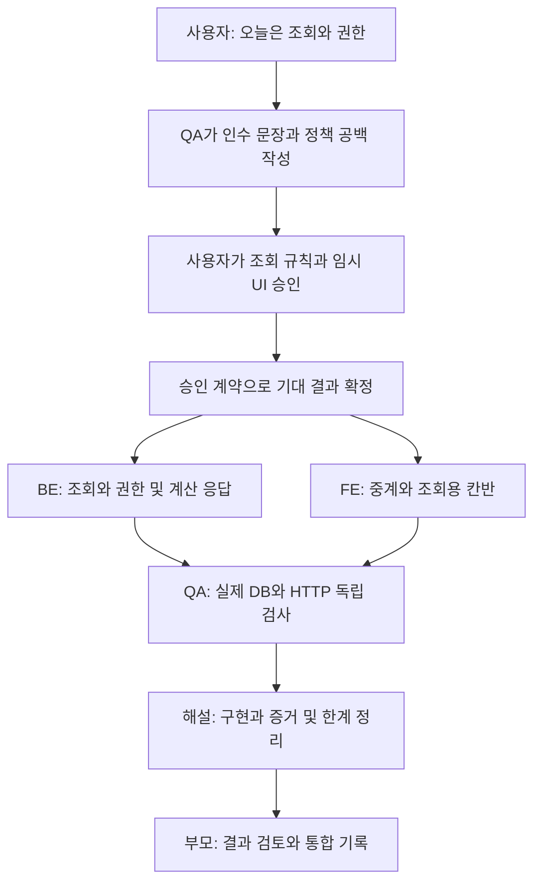
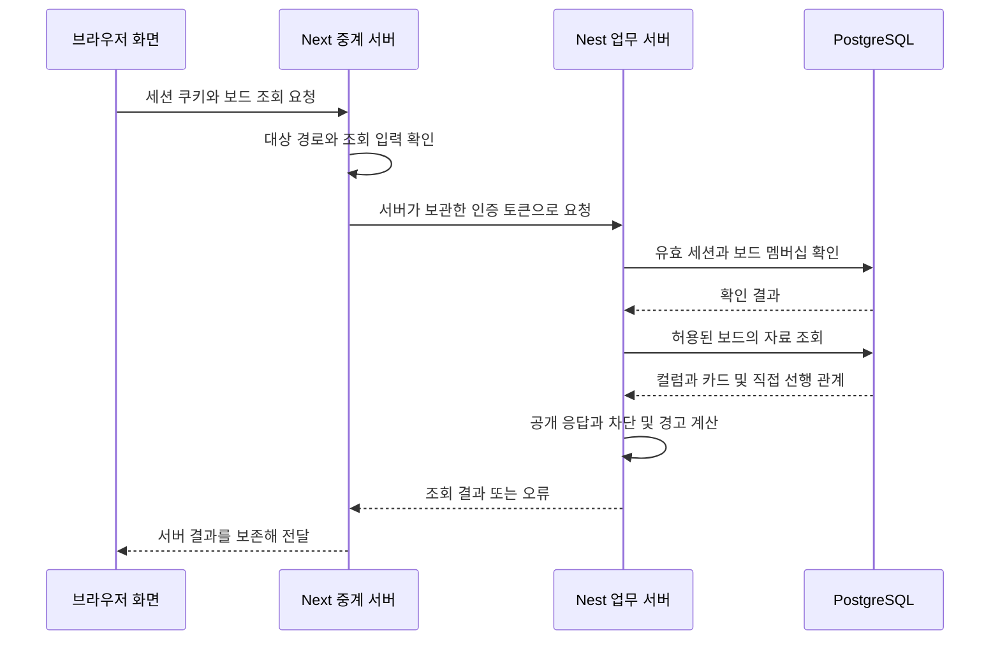
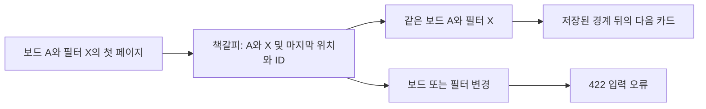

# 사이클 02 — 참여한 보드의 내용을 정확하게 읽기

대상 작업: 2026-10-12에 시작한 조회·권한 사이클. 문서 작성: 2026-10-13.
통합 기준 `f54bb70` · BE `c08f3e3` · 최종 FE `7509f57` · QA 보고 `845d560`.
실제 서버 검사의 FE 기준은 수정 전 `53c1b52`이며, 최종 수정본의 별도 검증과 아래에서 구분합니다.

이번에는 내 보드 목록에서 보드 상세로 들어가 컬럼과 카드를 읽는 서버 연결과 임시 칸반 화면을 만들었습니다.
칸반은 할 일을 진행 단계별 칸에 나눠 보여 주는 화면입니다. 이번 화면은 조회용이며 카드 생성·이동은 다음 작업으로 남겼습니다.
실제 브라우저 클릭·시각 검증과 Figma 정밀 일치는 아직 확인하지 않았습니다.

코드를 읽을 필요는 없습니다. **협업 그림 → 권한 표 → 카드 상태 예시 → 검증 표 → 다음 작업** 순서로 보세요.
[사이클 01](cycle-01.md)의 로그인과 내 보드 생성 기반이 이번 상세 조회의 출발점입니다.

## 1. 왜 조회만 한 사이클로 나눴나

보드를 보는 기능도 저장된 카드를 꺼내는 일로 끝나지 않습니다.
다른 보드의 자료가 섞이지 않는지, 어떤 순서로 나오는지, 다음 페이지와 필터를 함께 써도 정확한지 정해야 합니다.
카드가 다른 카드 때문에 막혀 있는 상태도 현재 관계에 맞춰 보여 줘야 합니다.

| 이번에 한 일 | 사용자에게 보이는 의미 |
|---|---|
| 보드 상세 조회 | 선택한 보드의 제목과 정보를 읽음 |
| 컬럼 목록 조회 | 보드의 진행 단계들을 순서대로 읽음 |
| 카드 목록 조회 | 카드와 태그, 차단 상태를 읽음 |
| 조회 권한 적용 | 참여한 보드만 읽을 수 있음 |
| 임시 칸반 연결 | 내 보드에서 상세로 이동하고 컬럼·태그로 걸러 보도록 구현 |

카드 생성·이동을 분리해 읽기 규칙과 권한을 먼저 확인할 수 있었습니다.
DB에 검사 카드를 직접 만들어 놓은 것은 제품의 카드 생성 기능을 구현한 것과 다릅니다.
DB는 데이터를 보관하는 데이터베이스이고, fixture는 검사에 쓰려고 따로 준비한 데이터입니다.

근거: [작업판](../../agents/BOARD.md), [BE 결과](../../agents/be/CYCLE02-RESULT.md).

## 2. 승인, QA, BE·FE는 어떻게 연결됐나

QA는 품질 검증 담당, BE는 서버·저장 담당, FE는 화면·브라우저 연결 담당입니다.
인수 문장은 어떤 조건에서 어떤 결과가 나와야 통과인지 미리 적은 기준입니다.
QA는 READ001~011의 선행 기준을 쓰면서 미확정 규칙도 표시했습니다.
예를 들어 다른 보드의 컬럼으로 필터를 걸면 오류로 할지 빈 목록으로 할지는 구현자가 임의로 선택할 일이 아니었습니다.

승인 → QA 기준 → 구현이라는 관계는 같지만, 실제로는 QA 초안을 먼저 써서 승인할 공백을 찾았습니다.
BE와 FE는 확정된 계약을 공유한 뒤 병행했습니다. 계약 기록은 이번에 조율 담당이 BE에 명시 배정한 예외이며, 구현자가 새 정책을 만든 것은 아닙니다.
제품 변경은 검증을 위해 먼저 통합 브랜치에 모였고, 최종 설명과 판정도 같은 브랜치에 기록합니다.
그림의 마지막 통합은 이 결과 정리를 뜻하며 `main` 반영이나 원격 전송을 뜻하지 않습니다.

| 담당 | 이번에 넘겨준 결과 |
|---|---|
| 사용자·조율 | 정책과 임시 UI 승인, 범위 분리, 환경·통합 조율 |
| QA | 선행 조회 규격, 미확정 사항 감사, 독립 검사 |
| BE | 세 조회 API, 권한, 정렬·필터·계산 필드, 자체 검사 |
| FE | 세 조회 중계, 페이지 모으기, 칸반·오류·필터 화면, 자체 검사 |
| 해설 | 진행 이유와 검증 범위를 설명하는 이 문서 |

근거: [조회 선행 규격](../../agents/qa/cases/board-read/CYCLE02.md), [승인 계약](../contract/v0.2.1.md).

## 3. 읽기 권한과 쓰기 권한은 별개다

API는 프로그램이 요청을 보내는 창구이고, HTTP는 웹 요청·응답 방식입니다.
이번에 추가한 GET은 데이터를 읽는 요청입니다. 세 창구는 보드 상세, 컬럼 목록, 카드 목록입니다.
로그인했는지 확인하는 인증과, 그 보드에 접근해도 되는지 확인하는 권한 검사는 다른 질문입니다.

| 요청한 사람·대상 | 이번 조회 결과 | 이유 |
|---|---|---|
| 참여한 보드의 Owner·Editor·Viewer | 200, 정상 응답 | 세 역할 모두 멤버이며 읽기는 허용 |
| 비멤버 또는 초대 미수락자 | 403 `NOT_MEMBER` | 초대만으로 멤버가 되지는 않음 |
| 형식은 맞지만 존재하지 않는 보드 | 403 `NOT_MEMBER` | 승인된 보드 존재·접근 응답 정책 |
| 무효 로그인 세션 | 401 `UNAUTHENTICATED` | 유효한 로그인 연결이 아님 |
| 보드 ID·조회 조건 형식 오류 | 422 `INVALID_INPUT` | 잘못된 입력 |

표는 각각의 검사 조건을 설명합니다. 여러 오류가 겹친 모든 요청의 검사 우선순위를 새로 정하는 표는 아닙니다.
Viewer에게 수정 권한이 없어도 읽기를 거절하지 않습니다. 화면에서 버튼을 숨기는 것만으로 서버 권한 검사를 대신할 수도 없습니다.

자료 조회 단계는 권한이 허용된 경우입니다. 거절된 요청은 보드 내용을 응답하지 않습니다.
Next의 BFF는 브라우저를 위한 중계 서버이고 Nest는 업무 규칙을 처리합니다. 인증 구조는 [이전 사이클](cycle-01.md)의 5절을 참고하세요.
그림은 구현 구조이며 실제 브라우저 조작 검증의 증거는 아닙니다.

## 4. 순서와 필터까지 약속해야 목록이 정확해진다

`position`은 배치 순서 값입니다. 컬럼과 카드 목록은 position이 작은 것부터, 같으면 ID가 작은 것부터 나옵니다.
카드는 여러 컬럼에서 position이 같을 수 있으므로 보드 전체 목록에도 동률을 가르는 기준이 필요했습니다.
화면은 서버 순서를 유지하면서 카드를 해당 컬럼에 나눠 보여 줍니다.

필터는 조건에 맞는 카드만 고르는 기능입니다. 여러 조건은 모두 만족해야 하는 AND 방식입니다.
태그 이름은 정확히 일치해야 하며 대소문자나 앞뒤 공백을 자동으로 바꾸지 않습니다.

| 조회 예시 | 승인된 뜻 |
|---|---|
| 컬럼 A + 태그 `Alpha` | A 안에 있고 태그 이름도 정확히 `Alpha`인 카드 |
| 태그 `alpha` | `Alpha`와는 다른 문자열 조건 |
| 형식이 맞는 다른 보드 컬럼 ID | 현재 보드에서 조건에 맞는 카드가 없어 빈 목록 |
| 형식이 틀린 컬럼 ID | 조건 자체가 잘못돼 422 |
| 빈 태그 문자열 | 빈 문자열 그대로 정확 일치 조건; 새 길이 제한 없음 |

빈 목록은 접근을 허용받은 보드 안에서 조건에 맞는 카드가 없다는 뜻입니다.
비멤버에게 403 대신 빈 목록을 주는 정책과 혼동하면 안 됩니다.

cursor는 다음 부분을 읽기 위한 책갈피입니다. 이번 카드 책갈피에는 position·ID와 함께 보드·필터 조건도 담습니다.
책갈피 비유의 한계는 목록 전체를 과거 모습 그대로 얼려 두는 기능이 아니라는 점입니다.

기준 카드가 삭제돼도 그 행을 다시 찾을 필요 없이 저장된 경계 뒤를 조회합니다.
조회 중 자료가 바뀌는 모든 상황에서 한 시점의 고정 목록인 스냅샷을 보장하지는 않습니다.
FE는 끝 페이지까지 같은 필터로 읽고 ID 중복을 막습니다. 같은 책갈피가 반복되면 무한 요청을 계속하지 않고 오류로 처리합니다.

근거: [조회 승인](../contract/v0.2.1.md), [BE 결과](../../agents/be/CYCLE02-RESULT.md), [FE 인계](../../agents/fe/OUTBOX.md).

## 5. blocked와 warnings는 왜 다를까

`blocked`는 직접 선행 카드가 아직 완료 컬럼에 있지 않아 현재 카드가 막혔는지 나타냅니다.
`warnings`는 현재 카드가 완료 컬럼에 있는데도 선행 카드 때문에 막혔을 때 보여 줄 경고 목록입니다.
선행은 “이 카드보다 먼저 처리할 카드”라는 관계이며, 이번 계산은 바로 연결된 선행 한 장의 컬럼 상태를 봅니다.

| 직접 선행 카드 | 현재 카드의 컬럼 | blocked | warnings |
|---|---|---|---|
| 없음 | 어느 컬럼이든 | false | 빈 목록 |
| 완료 컬럼에 있음 | 어느 컬럼이든 | false | 빈 목록 |
| 완료가 아닌 컬럼에 있음 | 완료가 아닌 컬럼 | true | 빈 목록 |
| 완료가 아닌 컬럼에 있음 | 완료 컬럼 | true | `BLOCKED_BY_PREDECESSOR` |

가상 예를 들면 선행 “초안 작성”이 진행 중인데 현재 “검토 완료” 카드가 완료 칸에 있으면 차단 상태와 경고가 함께 나옵니다.
화면은 임의로 다시 판단하지 않고 서버가 준 값을 표시합니다.
`completed` 저장 필드를 새로 만들거나 blocked·warnings를 DB에 저장하지도 않았습니다.
조회할 때 계산하므로 선행 카드의 컬럼 상태가 바뀌면 이후 조회 결과도 달라질 수 있습니다.

읽기는 version, 수정 시각, 위치, 관계를 바꾸지 않아야 합니다. 실제 검사도 반복 조회 뒤 DB 상태가 그대로인지 살폈습니다.
새 schema, 즉 DB 구조나 migration, 즉 구조 변경 절차를 추가하지 않고 기존 자료로 조회 기능을 확장했습니다.

## 6. 화면 구현과 실제 확인을 나누기

FE는 내 보드의 상세 링크, 조회용 칸반, 컬럼·태그 필터, 로딩·빈 목록·오류 상태를 구현했습니다.
보드·컬럼·모든 카드 페이지를 성공적으로 읽기 전에는 일부 자료만 완성된 보드처럼 보여 주지 않도록 했습니다.
401이면 로그인 흐름으로, 403이면 보드 내용을 노출하지 않는 상태로 처리합니다.
담당자 ID와 페이지 크기도 API·URL로 전달하지만 새 멤버 검색 화면이나 ID 입력용 제품 흐름을 만들지는 않았습니다.

Figma 상세 자료 요청은 호출 한도로 실패했습니다. 사용자는 이번에도 임시 UI를 먼저 만들고 디자인을 보정하도록 승인했습니다.
UI는 사용자 화면이라는 뜻입니다. 현재 화면을 Figma 정밀 일치 통과로 표시하지 않습니다.
컴퓨터 조작 도구에서 사용할 브라우저가 없어 실제 클릭과 시각 검사는 실행하지 못했습니다.
서버의 상세 페이지 HTML 응답 200 확인은 브라우저가 모든 자료를 불러와 올바르게 그렸다는 뜻이 아닙니다.

## 7. 독립 QA가 찾은 작은 입력 차이

페이지 크기를 뜻하는 `limit`은 숫자로 된 문자열과 1~100 범위를 검사합니다.
QA는 화면이 주소의 `limit=1e1`을 즉시 숫자 10으로 바꿔 요청하는 문제를 찾았습니다.
서버는 원문 `1e1`을 잘못된 입력으로 거절하는데 화면이 이를 정상 값처럼 바꿔 버린 것입니다.
숫자로 계산할 수 있다는 것과 제품이 허용한 입력 형식이라는 것은 같지 않습니다.

FE는 원문 형식·정수·범위를 변환 전에 검사하도록 고쳤습니다. 같은 단일 조건을 여러 번 보낸 입력도 거절합니다.
QA는 최종 `7509f57`에서 코드 검토와 독립 mock 19개로 수정 결과를 확인했습니다.
정상 `1`, `100`, `010`과 잘못된 `1e1` 등을 구분했으며, 이미 종료된 서버를 다시 켜 실제 HTTP 검사를 반복하지는 않았습니다.
이 사례는 실제 서버 검사가 통과해도 화면의 입력 처리 경계에는 별도 문제가 남을 수 있음을 보여 줍니다.

## 8. 검사 숫자는 무엇을 뜻하나

mock은 DB나 상대 서버 대신 정해진 응답을 주는 대역입니다. 실제 DB 검사는 진짜 저장 상태를, 실제 HTTP 검사는 요청·응답 연결을 확인합니다.
빌드는 코드가 실행 산출물로 만들어지는지 확인하는 절차입니다. 빌드 성공만으로 사용자 동작이 모두 통과하지는 않습니다.

| 증거 묶음 | 결과 | 확인 범위와 한계 |
|---|---|---|
| BE 자체 검사 | 9개 묶음의 49 tests, 빌드 통과 | 단위·mock HTTP 검사. 실제 DB 검사와 구분 |
| BE 실제 DB·HTTP | 8 checks 통과 | 역할별 조회, 경계, 순서·필터·계산값, 페이지, 입력·세션, 읽기 불변 |
| FE 최초 구현 | 18 mock, 타입 검사·빌드 통과 | 중계·브라우저 연결 코드. 실제 클릭 검사 아님 |
| QA 독립 실제 DB·API·BFF | FE `53c1b52` 기준 19 checks 통과 | 실제 역할·경계·순서·필터·페이지·세션·읽기 불변. 실제 브라우저 검사는 아님 |
| FE 최종 페이지 크기 보완 | `7509f57`에서 FE mock 19개·타입 검사·빌드 통과 | FE 자체 보고. 앞선 실제 검사를 수정본 재실행으로 표시하지 않음 |
| QA의 최종 FE 독립 확인 | 코드 검토와 mock 19개 통과 | 원문 limit 문제의 복구 확인. 새 실제 HTTP·브라우저 실행 없음 |
| QA의 BE 독립 모의 HTTP | 3개 통과 | 실제 Nest 요청 처리, 저장·인증 부분은 대역. 실제 세션 증거는 위 실제 19개 |

49·8·18·19는 서로 다른 범위이고 일부 행동을 겹쳐 확인합니다. 더해서 전체 통과 수나 완성률로 쓰지 않습니다.
선행 문장 READ001~011의 개수와 실행 도구의 검사 수 19도 일대일 관계라고 가정하지 않습니다.
이전 사이클의 FE 41개 통과를 이번 조회 기능의 증거로 재사용하지 않습니다.
브라우저의 쿠키 자동 전송·클릭·화면 배치 검증은 서버 HTTP 검사와 별개입니다.

QA 실제 검사는 새 사용자·카드·세션을 SQL로 준비했습니다. 기존 가입·로그인 발급 기능을 다시 검사한 결과로 표시하지 않습니다.
삭제한 책갈피 기준 카드 뒤를 이어 읽는 검사는 실제 API에서 확인했고, 삭제 직후 같은 BFF 요청까지 반복한 것은 아닙니다.
선행 카드의 검사 데이터를 바꿔 계산값을 확인한 뒤 복원했으며, 제품 카드 이동 API를 검증한 것은 아닙니다.
READ001~011에는 실제 증거가 생겼지만 각 문장의 미검증 범위도 남습니다. 기존 업무 13개와 이전 규격 전체를 자동 통과로 바꾸지 않습니다.
QA는 확인한 서버 조회·권한 범위와 좁은 입력 수정에서 차단 결함을 발견하지 않았다고 판정했습니다.

근거: [최종 QA 결과와 규격별 한계](../../agents/qa/live/CYCLE02-RESULTS.md), [FE 최종 상태](../../agents/fe/STATUS.md).

## 9. 현재 통합 상태와 다음 사이클

부모가 서버 종료 상태를 확인했습니다. API 3301, Next 3002·3003, 격리 DB 55432는 종료됐고 DB 데이터는 보존했습니다.
이번은 통합 브랜치 `codex/orchestration` 범위입니다. 이번 변경의 `main` 병합과 원격 push는 수행하지 않았습니다.
이전 사이클의 main 반영 기록과 이번 상태를 구분해야 합니다.
Git commit은 변경 이력 저장, merge는 이력 합치기, push는 원격에 이력 보내기입니다. 부모가 맡습니다.

사용자가 말한 “내일”은 다음 카드 생성·이동 사이클을 가리킵니다. 10월 13일 사용자는 계속 개발을 요청했고, 부모는 미확정 정책 세 가지의 답변을 기다리는 상태입니다.
새 요청은 이번 조회 사이클의 카드 쓰기 구현 완료를 뜻하지 않습니다. 아래는 확정된 기존 계약의 학습 예고이며 미확정 답변을 대신하지 않습니다.
다음에는 “실패했을 때 데이터가 남거나 이동하지 않는가”도 살펴야 합니다.

| 다음에 살필 개념 | 쉬운 뜻 | 기존 계약에서 주의할 점 |
|---|---|---|
| 카드 생성 | 새 카드를 저장 | fixture 준비를 제품 생성 API 통과로 대신하지 않음 |
| WIP 한도 | 한 컬럼에 동시에 둘 수 있는 카드 수 제한 | 생성·이동에서 도착 컬럼을 잠그고 수를 확인 |
| If-Match | 내가 본 버전이 아직 최신인지 보내는 조건 | 버전 대상 쓰기에 없으면 428, 다르면 409이며 행 불변 |
| 카드 이동 | 같은 보드의 다른 컬럼으로 옮김 | WIP 초과면 409이며 기존 column_id 유지 |
| 실패 후 불변 | 거절된 작업이 자료를 바꾸지 않음 | 화면 오류뿐 아니라 실제 저장 결과도 검사 |

WIP는 Work In Progress, 즉 진행 중인 작업 수입니다. 남은 자리를 확인하는 비유가 가능하지만 두 요청이 동시에 마지막 자리를 볼 수 있어 잠금까지 필요합니다.
If-Match의 버전 확인은 다른 사람이 그사이 바꾼 내용을 덮어쓰지 않기 위한 장치입니다.
두 개념은 읽기 권한 검사와 다른 문제입니다. 다음 QA 문장은 정상 생성·이동뿐 아니라 초과·충돌·거절 뒤 불변을 먼저 정해야 합니다.
이는 기존 계약의 학습 예고이며 새 구현 완료나 추가 정책 승인을 뜻하지 않습니다.

근거: [트랜잭션·버전 계약](../contract/v0.2.1.md), [WIP·이동 규격](../contract/feature-spec.md).

## 10. 짧은 학습 질문

1. Viewer는 왜 읽기에 성공하나요? → 쓰기 권한이 없어도 멤버인 보드의 조회는 허용되기 때문입니다.
2. 필터를 바꾸고 이전 책갈피를 쓰면 왜 오류인가요? → 원래 보드와 필터의 정렬 경계이기 때문입니다.
3. blocked가 true면 항상 경고도 있나요? → 현재 카드도 완료 컬럼에 있을 때만 경고가 생깁니다.
4. 검사 DB에 카드가 있으니 카드 생성 기능도 완성됐나요? → 검사 데이터 준비와 제품 API 구현은 다릅니다.
5. 다음 이동 기능에서 화면만 보면 충분한가요? → 거절 뒤 실제 DB의 위치와 버전도 확인해야 합니다.
6. 실제 검사 19개와 최종 mock 19개는 같은 검사인가요? → 서로 다른 구현 시점과 방식으로 수행한 별도 증거입니다.
