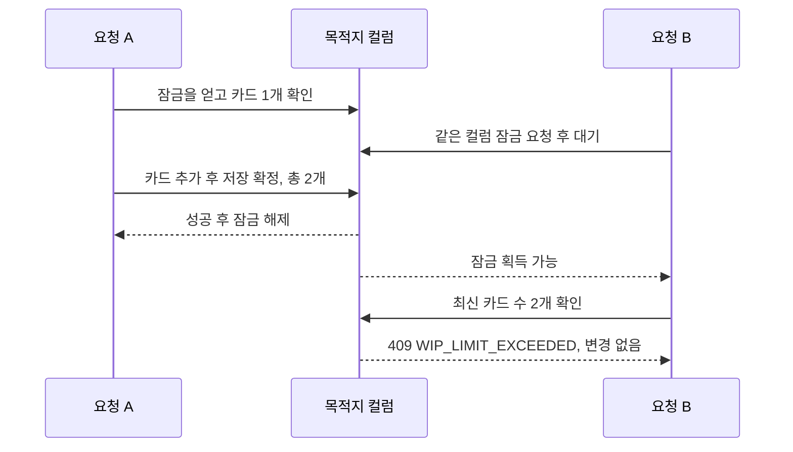
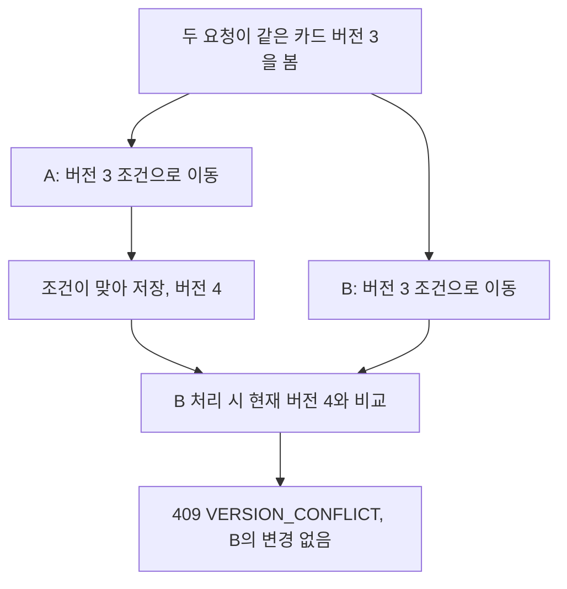
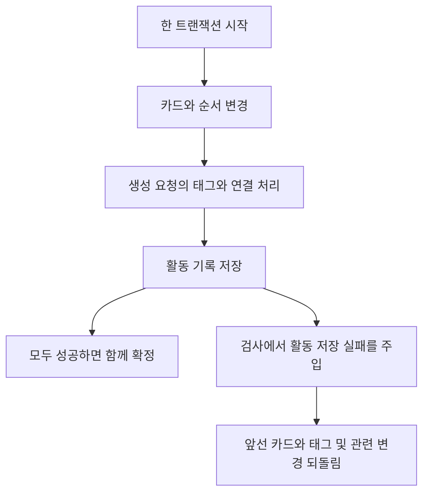

# 사이클 03 — 카드를 만들고 옮겨도 데이터가 어긋나지 않게 하기

작성: 2026-10-13. 제품 기준: BE `1618099`, FE `b785965`.
통합 기준 `97401c4`, 최종 QA 보고 `b63ba79`. BE 최종 인계 `98b80a6`은 문서 변경이며 제품 소스는 같습니다.

[사이클 02](cycle-02.md)에서는 보드의 내용을 읽었습니다. 이번에는 카드를 만들고 위치를 옮기는 기능을 연결했습니다.
읽기와 달리 쓰기는 다른 사용자의 동시 작업, 자리 부족, 오래된 화면, 저장 도중 실패까지 다뤄야 합니다.
이번 학습의 핵심은 **자리 수·버전·저장 묶음이 각각 다른 문제를 해결한다**는 것입니다.

코드 없이 읽으려면 승인 표 → 마지막 자리 그림 → 버전 그림 → 원자성 그림 → 검사 도구 사례 순서로 보세요.
실제 브라우저 클릭·화면 검증과 Figma 정밀 일치는 여전히 미검증입니다.

## 1. 사용자 결정이 구현 기준이 되기까지

사용자는 카드 순서, 같은 컬럼 안의 이동, 태그 처리 정책과 임시 UI를 승인했습니다.
UI는 사용자가 보는 화면입니다. Figma 디자인과 정밀하게 맞추는 보정은 후속 작업으로 남겼습니다.
이전 문서의 “다음 카드 정책 질문 대기”는 당시 상태이며 이번 승인으로 결정된 부분은 아래와 같습니다.

| 결정 | 승인된 동작 | 필요한 이유 |
|---|---|---|
| 카드 생성 위치 | 선택한 컬럼의 맨 끝 | 새 카드가 들어갈 위치를 일정하게 정함 |
| 이동 위치 | 지정한 카드 앞, 기준을 생략하면 끝 | 사용자가 위치를 선택할 수 있게 함 |
| 순서 번호 간격 부족 | 목적지 컬럼을 1024 간격으로 재정리 | 번호 사이에 더 넣을 공간이 없을 때도 순서 유지 |
| 같은 컬럼 이동 | 허용하며 카드 수를 셀 때 자신 제외 | 이미 있던 카드를 새 카드처럼 중복 계산하지 않음 |
| 결과가 같은 이동 | 성공하되 버전·활동 기록은 변경하지 않음 | 바뀐 내용이 없는데 변경 이력을 늘리지 않음 |
| 자기 자신 앞 이동 | 422 입력 오류 | 의미가 없는 삽입 기준을 거절 |
| 새 태그 | 보드 안에서 자동 생성, 대소문자만 다르면 기존 태그 재사용 | 같은 태그가 중복 생성되지 않도록 함 |

태그는 기존 표기를 유지하고 같은 요청의 중복은 하나로 묶습니다. 공백은 임의로 제거하지 않습니다.
이 태그 **생성·재사용 규칙**과 사이클 02의 **조회 필터 정확 일치 규칙**은 목적이 다릅니다. 한쪽 규칙으로 다른 쪽을 바꾸지 않습니다.

| 협업 단계 | 이번에 한 일 |
|---|---|
| 정책 승인·계약 정리 | 사람이 읽는 계약과 OpenAPI 요청·응답 약속을 맞춤 |
| QA 선행 | WRITE001~012에 정상·거절·동시 요청·실패 뒤 불변을 작성 |
| BE 구현 | 생성·이동 API, 권한, 잠금, 버전, 순서, 태그, 저장 묶음 |
| FE 병행 | 브라우저 중계, 생성·이동 폼, 중복 제출 방지와 오류 처리 |
| 독립 QA | 실제 서버·DB에서 응답과 저장 결과를 함께 검사 |
| 부모·해설 | 검사 가정 검토, 서버 종료·보존, 결과와 한계를 통합 기록 |

QA는 품질 검증, BE는 서버·저장, FE는 화면·브라우저 연결 담당입니다.
선행 인수 문장은 구현 전에 “어떤 조건에서 어떤 결과여야 통과인가”를 적은 기준입니다.
단순히 성공 화면만 정하지 않고 실패할 때 바뀌면 안 되는 데이터까지 정했습니다.

근거: [승인 계약](../contract/v0.2.1.md), [WRITE001~012](../../agents/qa/cases/card-write/CYCLE03.md).

## 2. 이번에 만든 범위와 권한

API는 프로그램끼리 요청하는 창구입니다. 이번 서버에는 두 개의 POST, 즉 변경 요청 경로를 추가했습니다.
`POST /columns/{columnId}/cards`는 카드 생성, `POST /cards/{cardId}/move`는 이동입니다.
브라우저는 Next의 BFF, 즉 화면 전용 중계 서버를 거쳐 Nest 업무 서버에 요청합니다. 인증 토큰은 기존 서버 보관 방식을 유지합니다.

| 요청 조건 | 이번 동작 |
|---|---|
| 참여한 보드의 Owner·Editor | 유효한 생성·이동 허용 |
| Viewer | 읽기는 가능하지만 쓰기는 403 `FORBIDDEN` |
| 비멤버·미수락 초대·없는 시작 자원 | 접근할 수 없다는 403 처리 |
| 무효 로그인 | 401로 거절 |
| 권한 확인 후 다른 보드의 자원 연결 | 422 `CROSS_BOARD` |
| 형식 또는 삽입 기준 오류 | 422 `INVALID_INPUT` |

작성자는 요청 본문의 주장이 아니라 인증된 사용자로 정합니다.
화면에서 Viewer의 쓰기 제어를 숨겨도 최종 권한은 서버가 판단합니다. 화면 표시만으로 권한 검사를 대신하지 않습니다.
카드 일반 수정·삭제, 기존 카드의 의존 관계 변경, 별도 태그 편집 API는 이번 범위가 아닙니다.

근거: [BE 결과](../../agents/be/CYCLE03-RESULT.md), [FE 인계](../../agents/fe/OUTBOX.md).

## 3. WIP — 마지막 한 자리를 두 요청이 동시에 원하면

WIP는 Work In Progress, 즉 진행 중인 작업 수입니다. 여기서는 컬럼에 허용한 카드 수 한도를 뜻합니다.
가상 예로 한도가 2이고 카드가 이미 1개라면 자리는 하나뿐입니다.
요청 A와 B가 동시에 빈자리를 보고 둘 다 들어오면 카드가 3개가 되어 한도를 넘습니다.

잠금은 같은 데이터를 바꾸는 작업이 서로의 중간 상태를 무시하고 진행하지 않게 하는 장치입니다.
이번에는 도착 컬럼을 잠근 뒤 현재 카드 수와 순서를 확인합니다.

그림의 수는 설명용 예시입니다. 실제 검사는 마지막 자리를 다투는 생성/생성, 생성/이동, 이동/이동 세 조합을 다룹니다.
줄 서기 비유가 가능하지만 서버에 화면용 대기줄이 생긴다는 뜻은 아닙니다. DB의 잠금으로 저장 처리를 조정합니다.
어떤 요청이 먼저 성공할지는 보장하지 않습니다. 중요한 것은 둘 다 성공해 한도를 넘지 않는다는 점입니다.

같은 컬럼 안에서 순서만 바꾸는 카드는 이미 자리를 차지하고 있으므로 자신을 제외하고 셉니다.
이동이 거절되면 카드는 원래 컬럼에 남고, 실패한 생성에는 새 카드나 태그 연결·활동 찌꺼기가 남지 않아야 합니다.
실제 검사에서는 응답 코드만 아니라 최종 카드 수와 저장 행까지 확인합니다.

## 4. If-Match — 자리가 있어도 오래된 화면이면 멈춘다

`version`은 카드 변경 판수입니다. `ETag`는 서버가 응답에 실어 주는 버전 표시이고, `If-Match`는 요청자가 자신이 본 버전을 보내는 조건입니다.
예를 들어 두 사람이 모두 버전 3을 보고 같은 카드를 다른 컬럼으로 옮기려 할 수 있습니다.
목적지에 자리가 충분해도 뒤늦은 요청이 앞선 이동을 모르고 덮어쓰면 안 됩니다.

버전 3·4는 이해를 돕는 예입니다. 이 조건부 변경을 CAS, 즉 현재 값과 기대 값을 비교해 맞을 때만 바꾸는 방식이라고 부릅니다.
If-Match가 없으면 428, 형식이 잘못됐으면 422, 현재 버전과 다르면 409로 구분합니다.
카드 이동에서는 따옴표로 감싼 양의 정수 버전을 사용하며 응답의 최신 버전을 다시 읽어 다음 판단에 씁니다.

| 장치 | 답하는 질문 | 실패 시 보호하는 것 |
|---|---|---|
| WIP 검사와 컬럼 잠금 | 목적지에 자리가 있는가? | 컬럼 한도 |
| 버전 조건과 CAS | 내가 본 카드가 아직 그 상태인가? | 다른 요청의 최신 변경 |
| 트랜잭션 | 관련 변경이 함께 성공했는가? | 일부만 저장된 불완전한 상태 |

트랜잭션은 여러 저장 작업을 하나로 묶어 전부 확정하거나 실패하면 함께 되돌리는 단위입니다.
WIP와 버전 검사는 서로 대체할 수 없습니다. 서로 다른 카드는 자리를 다툴 수 있고, 같은 카드는 서로 다른 목적지로 이동을 다툴 수 있기 때문입니다.

## 5. 순서 번호를 정리하거나 아무것도 바꾸지 않는 이동

`position`은 순서를 나타내는 정수 값입니다. 두 번호 사이에 여유가 있으면 그 사이에 넣을 수 있습니다.
예를 들어 0과 1024 사이에 512를 넣는 식입니다. 계속 끼워 넣으면 더 쓸 정수가 없는 구간이 생길 수 있습니다.
사용자가 승인한 방식은 목적지 컬럼을 1024 간격으로 다시 정리하는 것입니다. 저장 가능한 정수 범위를 벗어날 때도 정리가 필요합니다.

| 상황 | 처리 | 버전·활동에 대한 의미 |
|---|---|---|
| 다른 카드 앞이나 끝으로 실제 이동 | 원하는 순서에 배치 | 실제 이동 카드의 버전과 활동 반영 |
| 간격 소진·정수 범위 초과 | 목적지 순서를 재정리 | 위치 값이 바뀐 기존 카드도 버전 증가 |
| 이미 그 위치인데 같은 이동 요청 | 200 성공, no-op | 버전·수정 시각·위치·활동 불변 |
| 자기 자신을 삽입 기준으로 지정 | 422 거절 | 변경 없음 |

no-op은 요청은 처리했지만 실제 변화가 없는 작업입니다. 예를 들어 이미 끝인 카드를 같은 컬럼의 끝으로 옮기라는 요청입니다.
성공이라고 언제나 버전이 올라가는 것은 아닙니다. 반대로 순서 재정리 때는 사용자가 직접 고르지 않은 다른 카드의 버전도 바뀔 수 있습니다.
화면이 성공·no-op·충돌 뒤 서버 자료를 다시 읽는 이유가 여기에 있습니다.

완료 컬럼으로 옮길 때 직접 선행 카드가 미완료여도 이번 계약은 이동을 허용하고 경고를 돌려줍니다.
`blocked=true`와 `BLOCKED_BY_PREDECESSOR` 경고를 표시하며, 완료 여부를 저장하는 새 카드 필드를 만들지는 않았습니다.

## 6. 원자성 — 카드만 남고 활동 기록이 빠지면 안 된다

원자성은 함께 처리하기로 한 변경이 모두 성공하거나 모두 취소되는 성질입니다.
카드 생성은 카드 행뿐 아니라 새 태그, 카드와 태그의 연결, 활동 기록을 만들 수 있습니다.
도중에 실패했는데 일부만 남으면 화면과 이력이 서로 어긋납니다.

그림의 태그 단계는 생성 요청에 해당합니다. 이동은 위치·버전·필요한 순서 재정리와 활동을 같은 묶음으로 처리합니다.
되돌림은 rollback이라고 부릅니다. 오류 메시지를 보여 주는 것만으로 되돌림이 입증되지는 않습니다.
검사는 실패 전에 저장 상태를 기록한 뒤 실패 후 카드·태그·연결·활동과 버전 등이 같은지 비교해야 합니다.

QA는 새 검사 데이터에 한정한 임시 trigger, 즉 DB 작업 때 실행되는 규칙으로 활동 저장을 실패시키도록 준비했습니다.
이 규칙은 해당 실행의 사용자·보드·정확한 카드 제목이 모두 맞을 때만 `P0001` 예외를 냈습니다. 기존 제품의 DB 규칙은 바꾸지 않았습니다.
실제 생성·이동이 각각 500을 반환했고, 요청 전후 전체 검사 데이터가 같으며 새 태그가 남지 않은 것을 확인했습니다.
검사 뒤 지정한 임시 규칙과 함수만 제거하고 DB에 남지 않았는지도 확인했습니다.
제거 후에는 **동일한 생성 요청이 201, 동일한 이동 요청이 200**으로 성공했습니다. 기존 사용자 데이터에 실패를 주입한 검사가 아닙니다.

태그 중복도 동시 요청에서 확인해야 합니다. 두 생성 요청이 대소문자만 다른 같은 새 태그를 동시에 만들 수 있기 때문입니다.
같은 보드에서 태그는 하나로 재사용되고 각각의 카드 연결은 올바르게 생겨야 합니다. 다른 보드의 태그까지 공유하는 규칙은 아닙니다.

## 7. 검사 도구에도 오류가 있을 수 있다

자동 검사 도구를 harness라고 부릅니다. 이 도구도 기대값과 입력 데이터를 사람이 작성한 프로그램입니다.
빨간 실패가 곧 제품 버그라는 뜻은 아니며, 초록 통과도 의도한 동작을 검사했는지 확인해야 합니다.

| 이번에 검토한 문제 | 잘못 판단할 수 있는 이유 | 확인할 원칙 |
|---|---|---|
| 응답에 creatorId를 요구한 기대값 | DB 작성자 저장과 공개 응답 필드는 다른 계약 | 작성자는 저장 결과로 확인하고 공개 응답에 없는 필드를 요구하지 않음 |
| 39자 태그를 정상 실험 입력에 사용 | 계약의 태그 길이 1~30을 넘으므로 앞단 입력 오류 발생 | 원하는 동작에 도달할 수 있는 유효한 검사 자료 준비 |
| 되돌림 실험의 태그 길이도 초과할 위험 | 저장 전에 거절돼 행이 안 생긴 것을 되돌림 성공으로 오인 가능 | 입력 거절과 실제 저장 실패를 구분하고 예상 실패 지점 확인 |

최종 QA 원문에서 첫 실행은 공개 응답의 creatorId 요구, 두 번째 실행은 39자 태그로 실패했음을 확인했습니다.
되돌림 실험용 태그도 45자였으므로 함께 줄였습니다. 이를 고치려고 제품 계약이나 제품 소스를 바꾸지 않았습니다.
부모 검토는 되돌림 실험에서도 긴 태그 때문에 원하는 실패 지점에 도달하지 못할 가능성을 짚었습니다.
입력 검사에서 즉시 거절돼 “아무것도 남지 않음”과, 저장을 시작한 뒤 실패해 “남은 것을 모두 되돌림”은 다른 증거입니다.
앞선 실패 실행을 통과나 제품 결함으로 기록하지 않았고, 거기서 부분적으로 통과한 수를 최종 19개에 더하지 않았습니다.
실패한 실행의 검사 데이터도 보존했습니다. 실험이 틀렸던 흔적을 지우는 대신 원인과 수정 이유를 남긴 것입니다.

근거: [QA 검사 도구 오류 이력과 실패 주입 결과](../../agents/qa/live/CYCLE03-RESULTS.md).

## 8. 이번 증거의 범위

mock은 실제 DB나 상대 서버 대신 정해진 응답을 주는 대역입니다. 실제 동시 요청과 DB 되돌림을 모의 검사만으로 입증하지는 않습니다.
빌드는 실행 산출물을 만들 수 있는지, 타입 검사는 코드에서 값의 종류가 맞는지 확인하는 절차입니다.

| 실행 주체·방식 | 결과 | 해석할 범위 |
|---|---|---|
| BE 자체 | 10개 묶음 64 tests와 빌드 통과 | 단위·mock. 실제 동시 경쟁 증거와 구분 |
| FE 자체 | 22 mock·타입 검사와 빌드 통과 보고 | 마지막 UUID 역할 비교 보완은 mock·타입 검사만 재확인; 최종 빌드로 확대하지 않음 |
| QA 독립 실제 DB·API·BFF | 실행 `c5f04bf7`의 19 checks 통과 | WIP 세 경쟁·CAS·태그·순서·원자성·권한·중계의 실행 범위 |
| QA 독립 BE 서비스·입력 검사 | 15 unit tests 통과 | 서비스의 저장 묶음은 mock. 실제 Nest HTTP를 호출한 검사 아님 |
| QA 독립 FE | 22 mock 통과 | 중계·브라우저 연결 도우미·역할 확인. React 화면 클릭 검사는 아님 |
| 브라우저·Figma | 미검증 | 실제 클릭·시각·정밀 디자인 일치로 확대하지 않음 |

64·22·19·15와 독립 재실행 22는 다른 범위이며 일부 행동이 겹칩니다. 합산해 제품 전체 통과 수나 완성률로 쓰지 않습니다.
WRITE001~012의 문장 수와 실행 검사의 수가 같을 필요도 없습니다. 한 검사가 여러 관찰을 하고 한 문장에 여러 미검증 조건이 남을 수 있습니다.
동시 검사는 실행한 조합의 결과입니다. 모든 부하·순서·경쟁 패턴에서 문제가 없다는 보장은 아닙니다.
이번 WIP 경쟁은 실제 업무 API로 확인했고 BFF를 통한 동시 경쟁을 따로 실행하지는 않았습니다.
번호 범위 초과 시 재정리는 실제 이동에서 확인했습니다. 같은 공통 처리를 쓰더라도 생성의 범위 초과를 별도 실제 검사한 것으로 표시하지 않습니다.
로그인 세션 등 준비 데이터는 SQL로 만들었고, **카드 생성·이동은 실제 HTTP로 호출**했습니다. 기존 로그인 발급을 다시 검사한 결과는 아닙니다.
QA 판정은 확인한 범위에 차단 제품 결함이 없다는 것입니다. 각 규격의 남은 범위는 원자료 표에 보존합니다.

근거: [최종 QA 결과와 규격별 증거](../../agents/qa/live/CYCLE03-RESULTS.md).

## 9. 화면과 실행 환경, 남은 일

FE는 임시 카드 생성 폼과 선택식 이동 제어, 중복 제출 방지, 401·403·409·422·428 오류 처리를 구현했습니다.
충돌이나 성공 뒤 최신 서버 자료를 다시 읽으며, 현재 필터에 따라 선택 가능한 카드가 제한되는 점을 안내합니다.
새 멤버 검색 API나 임의의 ID 입력 흐름을 만들지 않았습니다. 서버 API의 선택 필드 지원과 화면의 입력 편의는 구분합니다.
실제 브라우저 조작·시각 검증과 Figma 보정은 후속으로 남습니다.

부모가 API 3301, Next 3002·3003, 격리 DB 55432의 TCP 연결이 닫힌 상태를 확인했습니다.
DB 데이터와 검사 결과 자료는 보존했고 기존 데이터를 초기화하거나 삭제하지 않았습니다. DB 구조를 뜻하는 schema와 구조 변경 절차인 migration도 바꾸지 않았습니다.
이번 변경은 통합 브랜치 `codex/orchestration` 범위이며 `main` 병합·원격 push는 수행하지 않았습니다.
문서와 제품 결과의 commit·최종 통합은 부모가 맡습니다. 이력 저장이 실제 배포나 브라우저 검증을 대신하지 않습니다.

| 이어서 구분해 볼 일 | 현재 위치 |
|---|---|
| 실제 생성·이동 서버 동작 | 독립 실행의 구체 범위로 판정 |
| 실제 브라우저 생성·이동·오류 표시 | 미검증 |
| Figma 정밀 보정 | 후속 |
| 카드 일반 수정·삭제·의존성 변경 HTTP | 이번 구현 범위 밖 |
| 나머지 기존 인수 규격 | 이번 결과로 자동 통과시키지 않음 |

## 10. 짧은 학습 질문

1. WIP와 버전 검사는 같은 문제를 해결하나요? → WIP는 목적지 자리, 버전은 카드의 최신 상태를 확인합니다.
2. 성공 응답인데 버전이 그대로일 수 있나요? → 순서가 달라지지 않는 no-op은 그대로입니다.
3. 태그만 남고 카드 생성이 실패해도 괜찮나요? → 이번 저장 묶음은 원자적이어야 하므로 실패한 변경이 남으면 안 됩니다.
4. 실패 뒤 행이 없으면 무조건 rollback이 입증되나요? → 입력 단계에서 거절됐을 수도 있어 실패 지점도 확인해야 합니다.
5. 검사 실패를 보고 바로 제품을 고치면 되나요? → 계약과 검사 기대·입력이 맞는지 먼저 구분해야 합니다.
