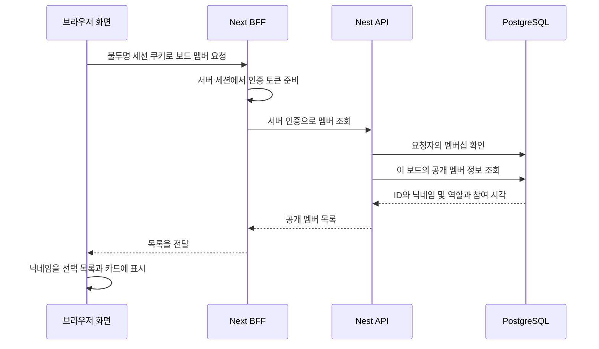
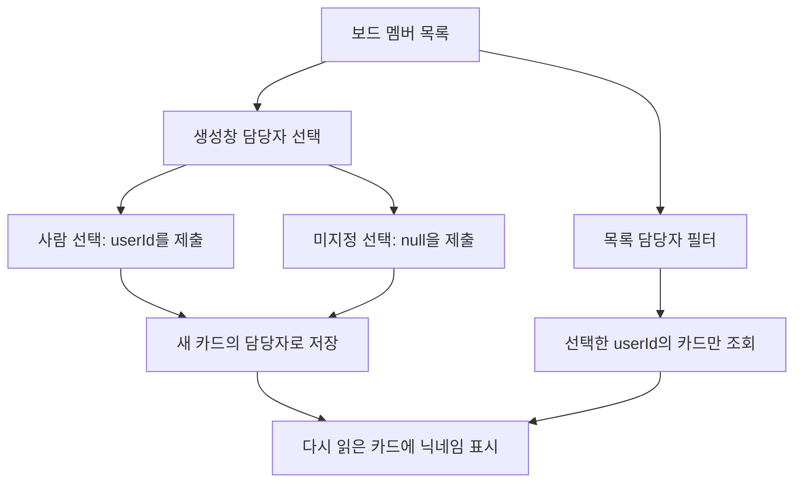
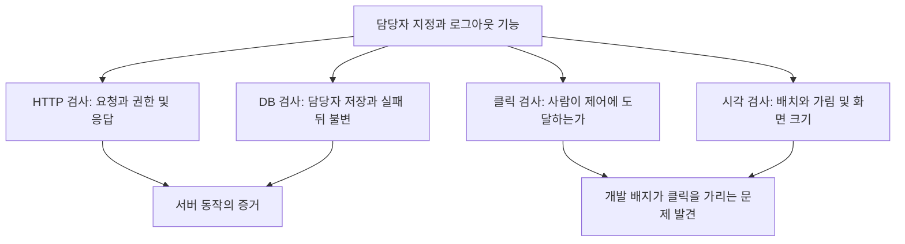

# 사이클 04 — 담당자를 고르고, 실제 화면에서 확인하기

작성: 2026-10-13. 통합 `f753b9a`, BE `7efe168`, FE 제품 `ceaa97b`, 최종 QA 보고 `36b5f9a`.
FE 인계 `e1622a4`는 문서 변경만입니다. 최종 QA 원문, 로그아웃 클릭 재검증과 서버 종료를 대조했습니다.

이번에는 카드 생성 때 실제 보드 멤버를 담당자로 선택하고, 담당자로 목록을 거르며, 카드에 닉네임을 표시하도록 연결했습니다.
이전 사이클에서 남았던 실제 브라우저 조작도 진행했습니다. Figma 보드 상세 원본을 확보해 화면의 구조·색·간격을 보정했습니다.
다만 기존 카드의 담당자를 나중에 바꾸는 기능까지 구현한 것은 아닙니다.

코드 없이 읽으려면 **공개 멤버 표 → 담당자 흐름 그림 → 로그아웃 사례 → 디자인 범위 → 검증 표** 순서로 보세요.
[사이클 03](cycle-03.md)은 카드 생성·이동의 서버 규칙을, 이번 문서는 그 기능을 사람이 화면에서 사용하는 연결을 설명합니다.

## 1. 서버에 있던 기능을 화면에서 쓰려면

이전 카드 생성 API는 담당자 ID를 받을 수 있었습니다. API는 프로그램끼리 요청과 응답을 주고받는 창구입니다.
그러나 사용자는 긴 ID를 알고 입력하는 대신, 보드 멤버 이름을 보고 선택할 수 있어야 합니다.
따라서 새 카드 저장 규칙을 만드는 것보다 먼저 **이 보드에서 누구를 선택할 수 있는지** 읽는 기능이 필요했습니다.

| 연결한 부분 | 이번 역할 |
|---|---|
| 멤버 계약 | 목록이 어떤 공개 정보를 반환할지 정함 |
| BE 멤버 조회 | 보드 접근 권한을 확인하고 공개 멤버 자료만 반환 |
| Next BFF 중계 | 브라우저 로그인 연결을 업무 서버 요청으로 이어 줌 |
| FE 담당자 선택 | 이름을 보여 주고 선택한 사람의 ID를 생성 요청에 담음 |
| 카드 목록·필터 | 담당자 닉네임 표시와 선택한 담당자의 카드 조회 |
| 독립 QA·부모 브라우저 검사 | 저장·권한 결과와 실제 클릭·화면 결과를 나눠 확인 |

BE는 서버 담당, FE는 화면 담당, QA는 품질 검증 담당입니다.
QA가 먼저 MEMBER001~003, ASSIGNEE001~003, UI001~002의 기대 동작을 적었습니다.
멤버·담당자 API의 독립 검사는 QA가, 실제 브라우저 클릭과 디자인 비교는 부모 조율 담당이 맡았습니다.
같은 작업을 검증해도 누가 어느 방식으로 확인했는지 구분해 기록합니다.

근거: [작업판](../../agents/BOARD.md), [선행 인수 기준](../../agents/qa/cases/member-assignee/CYCLE04.md).

## 2. 멤버 목록은 사용자 정보 전체가 아니다

기존 계약의 `GET /boards/{boardId}/members`를 실제 서버에 연결했습니다.
이번 구현은 아래 네 필드를 공개합니다. 필드는 응답에 담기는 이름 붙은 정보 한 항목입니다.

| 필드 | 뜻 | 화면에서 쓰는 이유 |
|---|---|---|
| userId | 사용자 식별자 | 담당자를 정확하게 지정하고 필터 조건으로 전달 |
| nickname | 표시용 닉네임 | 사람이 목록과 카드에서 알아보기 쉽게 표시 |
| role | Owner·Editor·Viewer 역할 | 멤버 역할 표시·화면 제어의 참고 정보 |
| joinedAt | 보드에 참여한 시각 | 멤버 응답의 참여 정보 |

계약에서 nickname은 선택 필드입니다. 이번 서버가 제공하더라도 화면은 빠졌을 때 안전한 대체 표시를 준비해야 합니다.
닉네임은 표시용이며 식별자는 userId입니다. 닉네임이 비슷해도 요청은 선택한 사람의 ID로 보냅니다.
이메일·비밀번호·세션·인증 토큰은 이 목록에 필요하지 않으므로 공개하지 않습니다.
BE는 사용자 자료 전체를 가져와 내보내는 대신 필요한 닉네임과 멤버 정보만 선택합니다.

학교의 팀 명단에 비유할 수 있지만, 앱의 권한은 명단이 눈에 보이는지만으로 정해지지 않습니다.
서버가 요청자의 보드 멤버십을 확인해야 하며, 화면에서 메뉴를 숨기는 것만으로 검사를 대신할 수 없습니다.

| 요청한 사람 또는 입력 | 멤버 조회의 기대 결과 |
|---|---|
| 보드의 Owner·Editor·Viewer | 200, 조회 허용 |
| 비멤버·미수락 초대·없는 보드 | 403 `NOT_MEMBER`, 자료 비노출 |
| 무효 로그인 | 401, 인증 거절 |
| 보드 ID 형식 오류 | 422, 입력 오류 |

이번은 해당 보드의 멤버 목록입니다. 모든 사용자 검색이나 멤버 역할 변경 기능을 새로 만든 것이 아닙니다.
구현은 참여 시각·사용자 ID 순으로 안정적으로 읽지만 별도 검색·페이지 정책까지 추가한 것은 아닙니다.

근거: [OpenAPI Member 계약](../contract/openapi.yaml), [BE 인계](../../agents/be/OUTBOX.md).

## 3. 멤버가 화면까지 오는 경로

BFF는 Backend for Frontend, 즉 화면을 위한 중계 서버입니다. 이번 앱에서는 Next가 중계를, Nest가 업무 API를 맡습니다.
브라우저는 로그인 연결을 가리키는 불투명한 쿠키 값을 보냅니다. 불투명하다는 말은 화면이 그 값을 열어 사용자 정보나 인증 토큰으로 해석하지 않는다는 뜻입니다.
실제 업무 서버용 토큰은 기존 방식대로 서버에서 관리합니다.

그림의 자료 조회는 권한이 허용된 경우입니다. 비멤버에게도 목록을 가져와 화면만 숨기는 방식이 아닙니다.
HttpOnly 쿠키는 화면 JavaScript가 읽지 못하게 하는 속성을 갖습니다. 쿠키를 쓰는 것과 인증 토큰을 화면 저장소에 공개하는 것은 다릅니다.
이번 작업은 이 인증 구조를 새로 바꾸는 작업이 아니라 기존 구조 위에 멤버 조회를 연결한 것입니다.

## 4. 같은 선택 목록도 생성과 필터는 다르다

dropdown은 눌러 펼쳐서 하나를 고르는 선택 목록입니다. 이번에는 실제 멤버 닉네임을 선택지로 사용합니다.
화면에 보이는 이름과 서버로 보내는 값이 다르다는 점이 중요합니다.

`null`은 담당자를 지정하지 않았다는 명시적인 빈 값입니다. “null”이라는 이름의 사람이나 빈 문자열 ID를 뜻하지 않습니다.
생성에서 미지정과 필터에서 전체 보기는 서로 다른 의미입니다.

| 조작 | 서버에 미치는 영향 | 기존 카드에 대한 의미 |
|---|---|---|
| 새 카드 생성에서 멤버 선택 | 새 카드 assigneeId에 userId 저장 | 기존 카드 담당자는 바뀌지 않음 |
| 새 카드 생성에서 미지정 | 새 카드 assigneeId를 null로 저장 | 담당자 없는 새 카드 |
| 목록에서 담당자 필터 선택 | 해당 userId 조건으로 조회 | 저장 자료를 수정하지 않음 |
| 카드의 담당자 닉네임 표시 | 응답 ID를 멤버 표시명과 연결 | 이름 표시가 담당자 변경은 아님 |

필터는 컬럼·태그 조건과 함께 쓰면 모두 만족하는 카드만 고릅니다. 지정한 사람의 필터에 미지정 카드를 섞지 않습니다.
화면이 목록에 보여 준 멤버라도 생성 시 서버가 관계와 쓰기 권한을 다시 검사합니다.
Viewer는 담당자 필터로 읽을 수 있지만 카드 생성 권한은 없습니다.
이미 저장된 카드의 담당자를 나중에 바꾸려면 별도의 PATCH, 즉 일부 수정 기능이 필요합니다. 그 기능은 이번에 구현하지 않았습니다.

## 5. 실제 클릭에서 새로 알게 된 것

이전 사이클에서는 브라우저 자동화 표면이 없어 실제 클릭을 하지 못했습니다. 이번에는 in-app browser 연결이 가능해져 부모가 직접 조작했습니다.
검사용 새 계정과 보드만 사용했고 로그인 자료는 추적하지 않는 비공개 실행 파일에 보관했습니다.
문서나 이미지에는 인증정보를 넣지 않았습니다.

| 실제 브라우저 행동 | 현재 확인한 결과 |
|---|---|
| Owner 로그인 후 내 보드에서 상세 링크 클릭 | 상세 화면 도착 |
| 생성창에서 QA editor 선택 후 새 카드 생성 | 저장 후 담당자 닉네임 표시 |
| QA editor 필터 선택·적용 | 해당 담당자 카드 3개만 표시 |
| 생성한 카드를 다른 컬럼으로 이동 | 목적지에서 카드 확인 |
| 같은 컬럼 맨 끝으로 다시 이동 | 변경 없음 안내 확인 |
| Viewer로 다시 로그인 | 조회·담당자 필터 가능, 생성·추가 버튼 0개 |
| 모바일 크기에서 폼 조작 | 내부 스크롤과 닫기 확인 |
| 로그아웃 | 첫 클릭의 개발 배지 가림 수정 후 실제 클릭으로 로그인 화면 도착 |

카드 수 3개는 이 검사 데이터에서 나온 결과입니다. 모든 보드가 세 장을 보여야 한다는 제품 규칙이 아닙니다.
같은 위치 이동의 변경 없음은 이전 사이클의 no-op 규칙이 화면에 표현된 것입니다.

가장 유익했던 발견은 로그아웃 버튼이었습니다. Next 개발 배지가 버튼 위를 가려 첫 실제 클릭을 방해했습니다.
개발 배지는 개발 서버에서 나타나는 보조 표시입니다. API가 정상적으로 로그아웃할 수 있어도 사람이 누르려는 위치가 가려지면 그 클릭 흐름은 통과하지 못합니다.
Enter로 성공한 결과는 키보드 경로의 증거이지, 마우스 클릭 문제까지 해결됐다는 증거가 아닙니다.
FE가 `devIndicators:false` 설정으로 개발 배지를 끄고 마지막 수정까지 빌드했습니다.
부모는 서버를 다시 시작한 뒤 실제 마우스로 로그아웃을 눌러 로그인 화면 도착을 확인했습니다. 클릭 경로의 문제도 이 재검증으로 복구를 확인했습니다.
수정 후 결과는 [로그아웃 클릭 이미지](../../agents/shared/design-cycle04/logout-click.jpg)와 실행 기록에 남겼습니다.

근거: [부모 실제 브라우저 결과](../../agents/shared/design-cycle04/BROWSER-RESULTS.md).

## 6. API 통과와 UI 통과는 다른 질문에 답한다

UI는 사용자 화면입니다. HTTP는 서버와 요청·응답을 주고받는 통신 방식입니다.
같은 기능을 검사하더라도 관찰 지점에 따라 잡을 수 있는 문제가 다릅니다.

DB는 실제 데이터를 저장하는 데이터베이스입니다. 서버 응답이 성공이어도 올바른 담당자 ID가 저장됐는지 확인할 수 있습니다.
반대로 DB가 정확해도 드롭다운이 잘못된 이름을 보여 주거나 버튼이 가려지면 사용자 작업은 잘못될 수 있습니다.
각 검사를 합쳐 판단하되 검사 숫자를 단순 합산해 전체 제품 완료로 바꾸지 않습니다.

## 7. Figma 원본을 어디까지 반영했나

이번에 확보한 원본은 Figma의 보드 상세 노드 `6:69`입니다. 노드는 디자인 파일 안에서 특정 화면이나 요소를 가리키는 단위입니다.
전체 디자인 코드와 실제 캔버스 화면을 참고했습니다. 후속 추가 조회는 도구 호출 한도에 막혔습니다.
첫 도구 로그의 잘린 이미지는 근거로 쓰지 않고 실제 원본 화면을 별도로 저장했습니다.

| 원본에서 확인한 기준 | 보정한 내용 |
|---|---|
| 사이드바 230px | 왼쪽 탐색 영역의 기본 폭과 색 |
| 상단 바 72px | 상단 영역의 높이와 구조 |
| 컬럼 316px, 사이 간격 14px | 칸반 컬럼의 폭과 간격 |
| 배경·카드·태그 색 | 원본 보드 상세의 색 구성 |

실제 보드에는 검사 카드, 경고, 담당자, 필터와 생성·이동 제어가 들어가므로 원본 예시와 내용·높이·상호작용이 달라집니다.
이번 결과는 해당 화면의 구조·색·간격 보정입니다. 모든 픽셀이 일치하거나 제품 전체 디자인이 완성됐다는 뜻은 아닙니다.
로그인·내 보드·생성창의 상세 원본은 이번에 확보하지 않았으므로 그 화면들의 정밀 일치를 주장하지 않습니다.
기본 보드 색상 정책 `#5534DA`도 디자인 보정 때문에 바꾸지 않았습니다.

부모는 데스크톱 1440×900과 모바일 390×844에서 확인했습니다. 모바일의 관찰된 페이지 폭 375는 390 안에 들어왔습니다.
이 결과는 해당 화면 크기와 검사 상태의 증거이며 모든 기기에서 검증했다는 뜻은 아닙니다.

이미지로 비교하려면 [Figma 보드 원본](../../agents/shared/design-cycle04/figma-board-reference.jpg), [실제 담당자 필터 화면](../../agents/shared/design-cycle04/board-assignee-desktop.jpg), [모바일 생성창](../../agents/shared/design-cycle04/dialog-mobile.jpg)을 보세요.

## 8. 검사 결과를 읽는 법

mock은 실제 DB나 상대 서버를 대신하는 응답 대역입니다. 코드 흐름을 확인하지만 실제 저장·클릭 검사를 대신하지는 못합니다.
빌드는 실행 산출물을 만들 수 있는지 확인하는 절차입니다.

| 주체·방식 | 현재 알려진 결과 | 범위·상태 |
|---|---|---|
| BE 자체 | 10개 묶음 65 tests·빌드 통과 | 역할 보고. 실제 브라우저 검사와 구분 |
| QA 독립 실제 API·BFF·DB | 11개 통과 | 공개 필드·권한·지정/null 생성·담당자 필터·실패 뒤 불변. FE 구현 중 실제 서버 실행 |
| QA 독립 Nest 요청 처리와 mock | 4개 통과 | 실제 요청 처리 경로, 저장·인증 부분은 대역. 실제 DB 검사와 별도 |
| FE 자체 | 최종 `ceaa97b`의 23 mock·타입 검사·빌드 통과 | 마지막 CSS·개발 배지 설정 보완까지 빌드 확인 |
| QA 독립 최종 FE | 23 mock 통과·코드 검토 | 멤버 경로·응답·오류·화면 연결 도우미 확인. 실제 React 화면 조작 검사 아님 |
| 부모 브라우저 | 위 표의 클릭·시각 결과 통과 | 개발 배지 수정 후 실제 로그아웃 클릭도 확인. 전체 화면·기기 검증으로 확대하지 않음 |

65·11·4·23과 브라우저 항목은 범위가 다르고 일부 동작을 겹쳐 확인합니다. 전체 통과 수나 완성률로 합산하지 않습니다.
담당자 ID가 저장된다는 서버 증거, 사람이 이름을 골라 생성했다는 클릭 증거, 카드에 이름이 보인다는 화면 증거를 각각 읽어야 합니다.
실제 11개는 FE 구현 중 서버에서 먼저 실행됐습니다. 최종 코드의 독립 mock·검토와 부모의 재기동 후 클릭은 별도 증거이며, 최종 코드로 실제 11개를 다시 실행했다고 표시하지 않습니다.
브라우저용 검사 보드와 QA HTTP 검사 보드는 따로 준비했습니다. 한쪽의 생성·세션 폐기가 다른 쪽 클릭 검사 자료를 바꾸지 않도록 나눴습니다.
검사 데이터를 SQL로 미리 준비한 것은 제품 생성의 통과 증거가 아닙니다. 이후 실제 API의 담당자 지정·미지정 생성과 부모가 화면에서 생성한 결과를 구분해 기록했습니다.
QA는 이번 HTTP 검증 범위에서 차단 결함을 발견하지 않았다고 판정했습니다.

근거: [최종 QA 결과와 항목별 한계](../../agents/qa/live/CYCLE04-RESULTS.md), [부모 클릭·시각 결과](../../agents/shared/design-cycle04/BROWSER-RESULTS.md).

## 9. 이번 범위의 경계와 인계

멤버 조회와 새 카드 담당자 선택은 기존 카드 담당자 수정과 다릅니다.
기존 카드의 담당자 변경 PATCH, 전체 사용자 검색, 역할 관리 기능은 이번 완료 범위에 포함하지 않습니다.
서버 API의 입력 검증·권한은 화면의 선택 목록이 생긴 뒤에도 유지해야 합니다.
이번에 브라우저를 실제로 조작했어도 모든 입력 오류·버전 충돌·네트워크 실패 안내, 같은 순간의 중복 클릭까지 전수 확인한 것은 아닙니다.
HTTPS 환경에서 브라우저가 쿠키를 전송하는 검사도 이번에는 실행하지 않았습니다.
닉네임이 없는 모든 경우, 멤버 탈퇴와 생성이 동시에 일어나는 경쟁 등도 QA 원문에 남은 범위로 기록됐습니다.
이전 사이클의 모든 규격을 이번 UI 결과만으로 자동 통과시키지 않습니다.

로그아웃 클릭 재검증 후 부모가 임시 API·웹 프로세스를 종료하고 격리 DB를 정상 종료했습니다.
3301·3002·3003·55432 네 포트 모두 연결 거절을 확인했으며 기존 DB 데이터는 보존했습니다.
최종 QA 원문과 실행 기준을 대조해 이 문서를 확정했습니다. 해설 담당은 제품 코드·정책·실행 환경을 변경하지 않았습니다.
이번 배정에는 `main` 병합과 원격 push가 포함되지 않습니다. 최종 문서 검토·commit은 부모가 맡습니다.

## 10. 짧은 학습 질문

1. 닉네임이 있는데 왜 userId도 필요한가요? → 이름은 표시용이고 담당자 지정·필터는 식별자로 해야 합니다.
2. 생성창의 미지정과 필터의 전체 보기는 같은가요? → 하나는 새 카드의 null 저장이고, 하나는 조회 조건 선택입니다.
3. Viewer가 담당자 필터를 쓰면 생성도 할 수 있나요? → 조회와 쓰기 권한은 다릅니다.
4. Enter로 로그아웃했으면 클릭도 통과인가요? → 버튼 가림처럼 입력 방식마다 다른 문제가 있을 수 있습니다.
5. Figma 보드 상세를 보정하면 생성창도 정밀 일치인가요? → 확인한 원본과 화면 범위가 다릅니다.
6. 새 카드에 담당자를 골랐으니 기존 카드도 바꿀 수 있나요? → 기존 카드 수정은 별도 PATCH 구현이 필요합니다.
